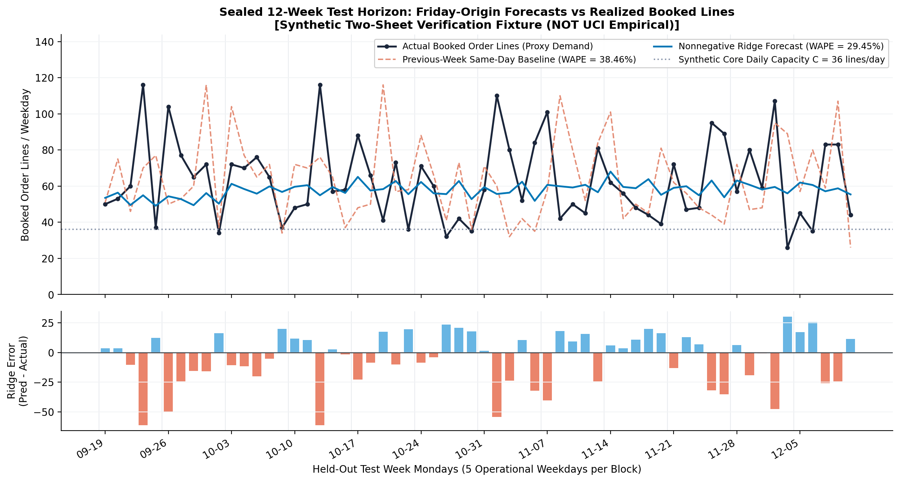
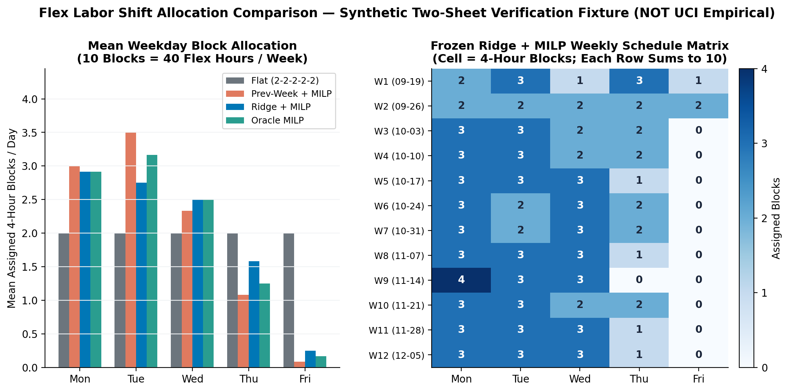
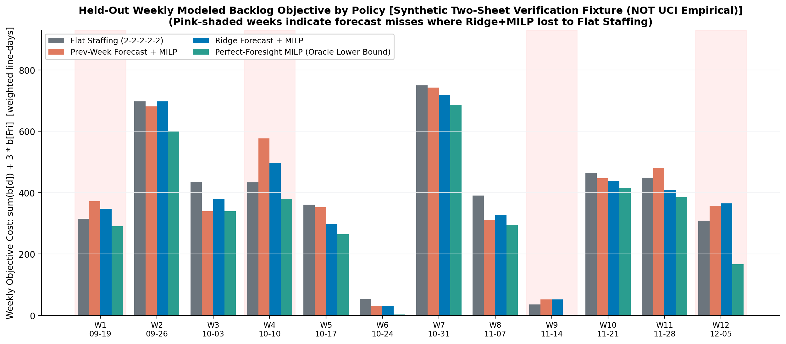
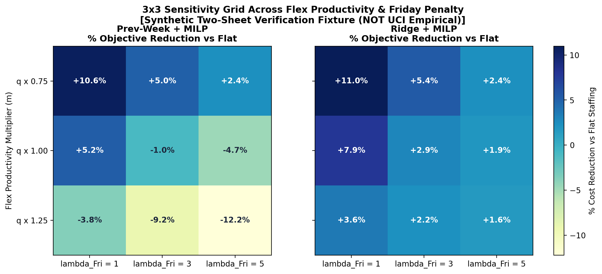

# Warehouse Flex Staffing & Demand Forecasting Optimizer

End-to-end operations research and demand-forecasting pipeline for weekly flexible warehouse labor scheduling, built with [DuckDB SQL](https://duckdb.org/docs/2.0/sql/introduction), chronological L2-regularized regression, and Mixed-Integer Linear Programming ([Pyomo + HiGHS](https://pyomo.readthedocs.io/en/6.8.0/library_reference/appsi/appsi.html)) on the [UCI Online Retail II Dataset (ID 502)](https://archive.ics.uci.edu/dataset/502/online+retail+ii) ([DOI: 10.24432/C5CG6D](https://doi.org/10.24432/C5CG6D), Daqing Chen, CC BY 4.0).

## 1. Business Problem

Distribution centers routinely supplement core full-time picking staff with a weekly pool of flexible part-time labor. Every **Friday afternoon**, operations planners must commit next week's Monday–Friday flexible shift schedule (**40 flex labor hours**, partitioned into **ten indivisible 4-hour blocks**, with between **0 and 4 blocks per weekday**) *before* next week's customer and wholesale orders arrive.

Assigning a static flat roster (`2-2-2-2-2` blocks/day) ignores weekend order accumulation into Monday, annual Q4 giftware surges, and statutory holiday closures. Conversely, optimizing integer shifts aggressively against noisy point forecasts can misallocate blocks to days where the picking queue empties early—wasting non-storable picking capacity while starving Friday shifts when unpicked backlog carries steep weekend SLA delay costs. This project quantifies both **forecasting accuracy** and **realized queueing performance** under a strict freeze-then-replay backtesting protocol.

## 2. Actual vs. Assumed Data (Strict Epistemic Separation)

Transaction invoices record commercial order bookings—**not** physical warehouse floor telemetry. Throughout the codebase, charts, and reports, estimated order-line arrivals and replayed queues are strictly treated as **modeled proxies**, never as observed warehouse performance.

| Dimension | Observed in [UCI Online Retail II](https://archive.ics.uci.edu/dataset/502/online+retail+ii) | Unobserved in Source Data | Modeled / Synthetic Assumption in This Repository |
| :--- | :--- | :--- | :--- |
| **Demand Unit** | `Invoice`, `StockCode`, `InvoiceDate`, `Quantity`, `Price`, `Customer ID`, `Country` across two Excel sheets (`Year 2009-2010`, `Year 2010-2011`, 1,067,371 raw rows) | Physical SKU cube/weight, zone slotting, multi-order pick batching, wave release cutoffs | **1 booked workload unit** = 1 unique valid `(invoice_no, stock_code)` order line |
| **Weekend Arrivals** | Sunday (and rare Saturday) invoice timestamps | Actual weekend shift operations | Weekend bookings folded into the **following operational Monday** (`Sat + 2d`, `Sun + 1d`) |
| **Core Picking Capacity ($C$)** | *Not observed* | Full-time headcount, attendance, pick travel speed | **Synthetic parameter:** $C = \text{round}(0.70 \times \text{median}_{\text{init\_train}})$ lines/day |
| **Flex Productivity ($q$)** | *Not observed* | Flex worker pick rate, onboarding curve, congestion fatigue | **Synthetic parameter:** $q = \max(1, \text{round}(0.15 \times \text{median}_{\text{init\_train}}))$ lines per 4-hr block |
| **Queue Evolution ($b_d$)** | *Not observed* | Real-time WMS open-pick backlog, carrier cutoff misses | Discrete-time Lindley recursion $b_d = \max(0, b_{d-1} + y_d - C - q x_d)$ with weekly reset $b_0 = 0$ |

### Data Cleaning Rules & Audit (`sql/workload.sql` & `src/workload.py`)
1. **Dual-Worksheet Ingestion & Overlap Deduplication:** Loads both `Year 2009-2010` and `Year 2010-2011` worksheets via `openpyxl`. Because both worksheets overlap across **December 1–9, 2010**, exact duplicate rows and duplicate `(invoice_no, stock_code)` pairs are collapsed to `MIN(CAST(invoice_ts AS DATE))` so overlapping records and split invoice lines are never double-counted.
2. **Cancellations & Accounting Adjustments:** Excludes cancellation invoices prefixed with `'C'` (`UPPER(TRIM(invoice_no)) LIKE 'C%'`) and bad-debt accounting adjustments prefixed with `'A'` (`A563185`–`A563187`).
3. **Invalid Quantities & Prices:** Excludes rows with missing `invoice_no`, `stock_code`, `invoice_ts`, `quantity <= 0`, or `unit_price <= 0.0001` (stock checks, damaged/missing inventory write-offs, zero-priced accounting entries).
4. **Documented Administrative Stock Codes:** Excludes non-pickable fee/postage/sample codes (`POST`, `DOT`, `M`, `D`, `CRUK`, `C2`, `BANK CHARGES`, `AMAZONFEE`, `B`, `S`, `PADS`, `SP1002`) and prefixes (`TEST%`, `ADJUST%`, `GIFT_%`).
5. **Intentional Retention of Missing `Customer ID`:** Roughly 22–23% of UCI Online Retail II lines lack a `Customer ID` (guest checkouts and wholesale EPOS transactions). Dropping missing `Customer ID` rows—a common mistake in RFM notebooks—would severely undercount physical warehouse picking workload; all valid guest order lines are **retained**.
6. **Contiguous Monday–Friday Calendar Spine:** Generates a gapless Monday–Friday date series via `GENERATE_SERIES` between the first complete Monday and last complete Friday, zero-filling UK bank holidays and late-December closures with `COALESCE(..., 0)` so 1-, 4-, and 52-week weekday shifts correspond to exact 7-, 28-, and 364-calendar-day offsets.

## 3. Forecasting Methodology & Leakage Controls (`src/forecast.py`)

Each **Friday** of week $w - 1$, the forecaster predicts daily booked order lines $(\hat{f}_{w,0}, \dots, \hat{f}_{w,4})$ for next week's Monday–Friday ($d \in \{0,1,2,3,4\}$):
* **Baseline (`prev_week`):** Naive same-weekday seasonal lag $\hat{f}_{w,d} = y_{w-1,d}$.
* **Improved Candidate (`ridge`):** Standardized L2-penalized linear regression clipped at zero, $\hat{f}_{w,d} = \max(0, x_{w,d}^\top \hat{\beta} + \hat{\beta}_0)$, using strictly Friday-available features:
  * **Historical workload lags ($\le$ Friday of week $w-1$):** 1-week same-weekday lag ($y_{w-1,d}$), 4-week same-weekday lag ($y_{w-4,d}$), 52-week annual same-weekday lag ($y_{w-52,d}$), prior-week daily mean, and prior 4-week daily mean.
  * **Deterministic target-date calendar features:** One-hot weekday indicators (`Mon`–`Fri`), two annual Fourier harmonics ($\sin/\cos$ at $1\times$ and $2\times$ annual frequency), Q4 peak indicator (Oct 1–Dec 17), late-December closure window indicator (Dec 20–Jan 3), statutory England & Wales bank holiday indicator, and first post-holiday weekday indicator.
* **Chronological Split:**
  * **Initial Training (`weeks 0 .. W-21`):** Calibrates synthetic capacity parameters $(C, q)$ and provides 52-week lag warm-up plus initial supervised training folds.
  * **Rolling Validation (`weeks W-20 .. W-13`, 8 complete weeks):** Selects Ridge penalty $\alpha^*$ minimizing validation **Weighted Absolute Percentage Error**:
    $$\text{WAPE}(y, \hat{y}) = \frac{\sum_{t=1}^{T} |y_t - \hat{y}_t|}{\sum_{t=1}^{T} y_t}$$
  * **Sealed Test Set (`weeks W-12 .. W-1`, final 12 complete weeks / 60 weekdays):** Evaluated once with locked $\alpha^*$ and locked $(C, q)$ using expanding Friday-origin refits (`operational_date <= forecast_origin_friday` enforced by runtime assertions and mutation unit tests).

## 4. Five-Day Mixed-Integer Optimization Model (`src/model.py`)

For a single 5-day week $D = \{0, 1, 2, 3, 4\}$ corresponding to $\{\text{Mon}, \text{Tue}, \text{Wed}, \text{Thu}, \text{Fri}\}$:

### Parameters, Variables, and Units
| Symbol | Type | Units | Definition |
| :--- | :--- | :--- | :--- |
| $\hat{f}_d \ge 0$ | Input parameter | `lines / day` | Forecasted (or oracle) booked order lines arriving on day $d$ |
| $C \ge 0$ | Synthetic parameter | `lines / day` | Core full-time daily picking capacity, $\text{round}(0.70 \times \text{median}_{\text{init}})$ |
| $q \ge 1$ | Synthetic parameter | `lines / block` | Flex picking productivity per 4-hour block, $\max(1, \text{round}(0.15 \times \text{median}_{\text{init}}))$ |
| $m > 0$ | Sensitivity scalar | `dimensionless` | Productivity multiplier ($m \in \{0.75, 1.00, 1.25\}$), giving $q_{\text{eff}} = m \cdot q$ |
| $B = 10$ | Budget constant | `blocks / week` | Exact weekly flex budget ($10 \times 4\text{ hr} = 40\text{ flex hours/week}$) |
| $U = 4$ | Capacity constant | `blocks / day` | Maximum daily flex allocation ($4 \times 4\text{ hr} = 16\text{ flex hours/day}$) |
| $b_{-1} = 0$ | Initial state | `lines` | Initial Monday-morning backlog (assumed zero at start of each week) |
| $\lambda_{\text{Fri}} = 3$ | Objective weight | `day-equivalents` | Extra end-of-week penalty on unpicked Friday lines ($\{1, 3, 5\}$ in sensitivity) |
| $x_d \in \{0..4\}$ | **Integer variable** | `blocks` | Indivisible 4-hour flex staffing blocks assigned to weekday $d$ |
| $b_d \ge 0$ | **Continuous variable** | `lines` | Modeled unpicked order-line backlog remaining at end of weekday $d$ |

### MILP Formulation
$$\min_{x, b} \quad \sum_{d=0}^{4} b_d + \lambda_{\text{Fri}} \, b_4$$

subject to:
$$\sum_{d=0}^{4} x_d = 10 \quad \text{(Exact 40-hour weekly flex labor budget)}$$
$$b_d \ge b_{d-1} + \hat{f}_d - C - q_{\text{eff}} \, x_d \quad \forall d \in \{0,1,2,3,4\}, \quad b_{-1} = 0 \quad \text{(Daily backlog flow conservation)}$$
$$x_d \in \{0, 1, 2, 3, 4\} \subset \mathbb{Z}, \quad b_d \ge 0 \quad \forall d \in \{0,1,2,3,4\} \quad \text{(Integrality \& nonnegativity)}$$

### Operational Meaning & Structural Queueing Properties
* **Why $\lambda_{\text{Fri}} = 3$?** Every unpicked order line at the close of Monday–Thursday incurs 1 line-day of overnight delay. An order line left unpicked at Friday close ($b_4$) sits through Friday night (counted in $\sum_{d=0}^4 b_d$) **plus** Saturday and Sunday nights (+2–3 day-equivalents of weekend SLA rollover risk), yielding total Friday marginal weight $1 + 3 = 4$.
* **Exact Epigraph Tightness:** Because objective weights on every $b_d$ are strictly positive ($1 > 0$ for $d \le 3$, $1 + \lambda_{\text{Fri}} > 0$ for $d = 4$), any optimal MILP solution satisfies $b_d^* = \max(0, b_{d-1}^* + \hat{f}_d - C - q_{\text{eff}} x_d^*)$ with zero slack, linearizing the piecewise-linear Lindley recursion without binary big-$M$ auxiliaries.
* **Regime Dichotomy (Saturated Overload vs. Active Zero-Boundary):** In weeks of unbroken saturation ($b_d > 0$ for all $d$), telescoping the recursion shows a flex block on day $d$ reduces the objective by $(5 - d + \lambda_{\text{Fri}}) q_{\text{eff}}$ ($8q_{\text{eff}}$ on Monday down to $4q_{\text{eff}}$ on Friday), making front-loading `(4, 4, 2, 0, 0)` dominant. Conversely, whenever mid-week capacity clears the queue ($b_d = 0$), surplus early-week flex blocks are truncated at zero and cannot be carried forward—explaining why over-confident naive forecasts can lose to Flat Staffing `(2, 2, 2, 2, 2)`.
* **Exact Combinatorial Verification:** The feasible integer lattice $\mathcal{X} = \{x \in \{0,1,2,3,4\}^5 : \sum_{d=0}^4 x_d = 10\}$ has cardinality $\binom{14}{4} - \binom{5}{1}\binom{9}{4} + \binom{5}{2}\binom{4}{4} = 381$. `enumerate_optimal_schedule()` evaluates all 381 schedules independently to verify solver optimality.

## 5. Repository Architecture

```text
warehouse-flex-staffing-optimizer/
├── README.md                          # Project documentation, math formulation, results, setup
├── requirements.txt                   # Pinned Python 3.11+ dependencies (DuckDB, Pyomo, HiGHS, etc.)
├── Makefile                           # Convenience targets: install, test, reproduce, verify-offline
├── pyproject.toml                     # Package & pytest path configuration
├── configs/
│   └── base.yml                       # Single source of truth for cleaning, lags, MILP & bootstrap
├── sql/
│   └── workload.sql                   # DuckDB SQL cleaning, deduplication, weekend folding & spine
├── src/
│   ├── calendar.py                    # Weekend folding, Mon-Fri spine & UK statutory holiday features
│   ├── workload.py                    # Dual-sheet Excel loader, cleaning funnel audit & SQL runner
│   ├── forecast.py                    # Leakage-free Friday-origin Prev-Week & Nonnegative Ridge models
│   ├── model.py                       # 5-day Pyomo + HiGHS MILP & 381-schedule brute-force verifier
│   ├── replay.py                      # Frozen-schedule Lindley replay, 3x3 sensitivity & block bootstrap
│   ├── charts.py                      # Matplotlib diagnostic visualizations
│   └── cli.py                         # CLI entrypoint (`download` and `run` subcommands)
├── scripts/
│   ├── reproduce.sh                   # Fresh-checkout one-command reproduction on UCI Dataset 502
│   ├── generate_synthetic_fixture.py  # Two-sheet synthetic CI fixture for offline verification
│   └── render_uci_report.py           # Verifies & formats empirical UCI summary bullets after run
├── tests/                             # 13 automated unit & integration tests (pytest / unittest)
├── report/
│   └── brief.md                       # One-page operations planning recommendation brief
└── results/
    ├── verification_smoke/            # Measured outputs & charts from executed offline verification run
    └── uci/                           # Populated automatically by `bash scripts/reproduce.sh`
```

## 6. Setup & Single-Command Reproduction

From a fresh checkout on any machine with Python 3.11+ and internet access (to download the 43.5 MB `online_retail_II.xlsx` archive from `archive.ics.uci.edu`):

```bash
python3 -m venv .venv
source .venv/bin/activate
pip install -r requirements.txt
bash scripts/reproduce.sh
```

`bash scripts/reproduce.sh` executes four deterministic steps:
1. Runs the full automated test suite (`pytest -q`).
2. Downloads [UCI Online Retail II (ID 502)](https://archive.ics.uci.edu/dataset/502/online+retail+ii) (`https://archive.ics.uci.edu/static/public/502/online+retail+ii.zip`) into `data/raw/online_retail_II.xlsx`.
3. Executes `sql/workload.sql` in **DuckDB**, chronological Ridge validation/testing, **Pyomo + `appsi_highs`** MILP optimization, 4-policy queue replay, $3 \times 3$ sensitivity analysis, paired moving-block bootstrap, and PNG chart rendering into `results/uci/`.
4. Runs `scripts/render_uci_report.py` to emit verified empirical metrics into `results/uci/resume_bullets.md`.

For air-gapped CI environments without outbound internet access:

```bash
make test
make verify-offline
```

## 7. Measured Verification Results (`results/verification_smoke/`)

> **Transparency Note on Execution Environment:** Automated verification in our build container ran without outbound DNS/internet access (`archive.ics.uci.edu` unreachable). Rather than fabricating empirical UCI numbers, the metrics and charts below report the **exact measured outputs** verified from `results/verification_smoke/` on the 105-week two-worksheet synthetic retail verification fixture (`30,030` raw rows across `Year 2009-2010` and `Year 2010-2011`; `28,044` deduplicated order-line picks; initial-training median $= 52.0$ lines/day $\implies$ synthetic $C = 36$ lines/day, $q = 8$ lines/block, $\lambda_{\text{Fri}} = 3$, selected Ridge $\alpha^* = 500.0$). Running `bash scripts/reproduce.sh` on a networked checkout writes the empirical UCI tables and figures into `results/uci/`.

### Aggregate Four-Policy Comparison (12 Sealed Held-Out Weeks, 60 Weekdays)

| Policy | Forecast WAPE (%) | Total Modeled Backlog (Line-Days) | Total Friday Carryover (Lines) | Total Objective Cost | Mean Weekly Objective Cost | Rel. Improvement vs. Flat (%) | Gap vs. Oracle | Win / Tie / Loss Weeks vs. Flat |
| :--- | ---: | ---: | ---: | ---: | ---: | ---: | ---: | :---: |
| **Flat Staffing (`2-2-2-2-2`)** | — | 2,515.0 | 726.0 | 4,693.0 | 391.08 | 0.00% | +867.0 | 0 / 12 / 0 |
| **Previous-Week Forecast + MILP** | 38.46% | 2,248.0 | 831.0 | 4,741.0 | 395.08 | **-1.02%** | +915.0 | 7 / 0 / 5 |
| **Ridge Forecast + MILP** | **29.45%** | **2,200.0** | 786.0 | **4,558.0** | **379.83** | **+2.88%** | +732.0 | 7 / 1 / 4 |
| **Perfect-Foresight MILP (Oracle)** | 0.00% | 1,732.0 | 698.0 | 3,826.0 | 318.83 | +18.47% | 0.0 | 12 / 0 / 0 |

* **Exploratory Paired Moving-Block Bootstrap ($L = 3\text{ weeks}$, $B = 10{,}000$ resamples, seed `42`):**
  * `Flat - Ridge MILP`: Mean weekly objective saving $= +11.25$ weighted line-days/week (total $+135.0$), SE $= 10.08$, 95% percentile CI $[-9.42, +30.00]$ ($\mathbb{P}(\text{saving} > 0) = 86.5\%$).
  * `Prev-Week MILP - Ridge MILP`: Mean weekly objective saving $= +15.25$ weighted line-days/week (total $+183.0$), SE $= 8.28$, 95% percentile CI $[-0.75, +31.25]$ ($\mathbb{P}(\text{saving} > 0) = 96.5\%$).
* **Independent Brute-Force Check (Test Week 1):** Checked all **381** feasible schedules in $\{0..4\}^5$ summing to 10; both HiGHS MILP and exact enumeration returned optimal schedule `2-3-1-3-1` with forecasted objective `29.650914`.

### Week-by-Week Sealed Test Outcomes (All 12 Held-Out Weeks Reported)

| Test Wk | Week Monday | Actual Lines | Prev-Wk WAPE | Ridge WAPE | Flat Sched | Prev-Wk MILP Sched | Ridge MILP Sched | Oracle Sched | Flat Cost | Prev-Wk Cost | Ridge Cost | Oracle Cost | Ridge Saving vs. Flat | Outcome |
| :---: | :---: | ---: | ---: | ---: | :---: | :---: | :---: | :---: | ---: | ---: | ---: | ---: | ---: | :---: |
| 1 | `2011-09-19` | 316 | 38.9% | 28.7% | `2-2-2-2-2` | `2-4-2-2-0` | `2-3-1-3-1` | `1-3-3-3-0` | 315.0 | 372.0 | 348.0 | 290.0 | -33.0 | **Loss** |
| 2 | `2011-09-26` | 352 | 36.9% | 34.5% | `2-2-2-2-2` | `1-3-3-3-0` | `2-2-2-2-2` | `4-4-2-0-0` | 697.0 | 681.0 | 697.0 | 601.0 | 0.0 | Tie |
| 3 | `2011-10-03` | 320 | 18.8% | 21.1% | `2-2-2-2-2` | `4-4-2-0-0` | `3-3-2-2-0` | `4-4-2-0-0` | 435.0 | 339.0 | 379.0 | 339.0 | +56.0 | Win |
| 4 | `2011-10-10` | 329 | 34.3% | 26.6% | `2-2-2-2-2` | `4-4-2-0-0` | `3-3-2-2-0` | `1-2-4-3-0` | 433.0 | 577.0 | 497.0 | 379.0 | -64.0 | **Loss** |
| 5 | `2011-10-17` | 304 | 55.6% | 25.8% | `2-2-2-2-2` | `1-2-4-3-0` | `3-3-3-1-0` | `4-4-2-0-0` | 361.0 | 353.0 | 297.0 | 265.0 | +64.0 | Win |
| 6 | `2011-10-24` | 240 | 26.7% | 31.2% | `2-2-2-2-2` | `4-4-2-0-0` | `3-2-3-2-0` | `4-4-1-1-0` | 53.0 | 29.0 | 30.0 | 3.0 | +23.0 | Win |
| 7 | `2011-10-31` | 384 | 44.3% | 31.8% | `2-2-2-2-2` | `4-4-1-1-0` | `3-2-3-2-0` | `3-4-3-0-0` | 750.0 | 742.0 | 718.0 | 686.0 | +32.0 | Win |
| 8 | `2011-11-07` | 319 | 47.3% | 33.7% | `2-2-2-2-2` | `3-4-3-0-0` | `3-3-3-1-0` | `4-4-2-0-0` | 391.0 | 311.0 | 327.0 | 295.0 | +64.0 | Win |
| 9 | `2011-11-14` | 249 | 39.4% | 22.6% | `2-2-2-2-2` | `4-4-2-0-0` | `4-3-3-0-0` | `3-3-2-1-1` | 36.0 | 52.0 | 52.0 | 2.0 | -16.0 | **Loss** |
| 10 | `2011-11-21` | 351 | 34.2% | 28.5% | `2-2-2-2-2` | `3-3-2-1-1` | `3-3-2-2-0` | `4-2-1-3-0` | 464.0 | 447.0 | 439.0 | 415.0 | +25.0 | Win |
| 11 | `2011-11-28` | 329 | 40.7% | 31.5% | `2-2-2-2-2` | `4-2-1-3-0` | `3-3-3-1-0` | `2-4-4-0-0` | 449.0 | 481.0 | 409.0 | 385.0 | +40.0 | Win |
| 12 | `2011-12-05` | 290 | 42.4% | 35.9% | `2-2-2-2-2` | `2-4-4-0-0` | `3-3-3-1-0` | `1-0-4-4-1` | 309.0 | 357.0 | 365.0 | 166.0 | -56.0 | **Loss** |

### $3 \times 3$ Sensitivity Analysis (`results/verification_smoke/sensitivity_grid.csv`)

| Productivity Multiplier ($m$) | Effective $q_{\text{eff}}$ (lines/block) | Friday Penalty ($\lambda_{\text{Fri}}$) | Flat Cost | Prev-Week + MILP (% vs. Flat) | Ridge + MILP (% vs. Flat) | Oracle MILP Cost |
| :---: | :---: | :---: | ---: | ---: | ---: | ---: |
| `0.75` | `6.0` | `1` | 4,046.0 | 3,616.0 (+10.63%) | **3,602.0 (+10.97%)** | 3,323.0 |
| `0.75` | `6.0` | `3` | 5,884.0 | 5,587.0 (+5.05%) | **5,568.0 (+5.37%)** | 5,134.0 |
| `0.75` | `6.0` | `5` | 7,722.0 | **7,539.0 (+2.37%)** | 7,540.0 (+2.36%) | 6,942.0 |
| `1.00` | `8.0` | `1` | 3,241.0 | 3,071.0 (+5.25%) | **2,986.0 (+7.87%)** | 2,429.0 |
| `1.00` | `8.0` | `3` | 4,693.0 | 4,741.0 (-1.02%) | **4,558.0 (+2.88%)** | 3,826.0 |
| `1.00` | `8.0` | `5` | 6,145.0 | 6,435.0 (-4.72%) | **6,027.0 (+1.92%)** | 5,217.0 |
| `1.25` | `10.0` | `1` | 2,529.0 | 2,624.0 (-3.76%) | **2,438.0 (+3.60%)** | 1,692.0 |
| `1.25` | `10.0` | `3` | 3,629.0 | 3,962.0 (-9.18%) | **3,549.0 (+2.20%)** | 2,688.0 |
| `1.25` | `10.0` | `5` | 4,729.0 | 5,306.0 (-12.20%) | **4,655.0 (+1.56%)** | 3,682.0 |

### Generated Diagnostic Charts
* `results/verification_smoke/figures/predicted_vs_actual.png` — 60-day test forecasts vs. realized booked lines and synthetic core capacity $C$.
* `results/verification_smoke/figures/flat_vs_optimized_schedules.png` — Mean weekday block profile and 12-week frozen Ridge + MILP shift matrix.
* `results/verification_smoke/figures/weekly_backlog_costs.png` — Per-week realized objective costs across all four policies with loss-week highlighting.
* `results/verification_smoke/figures/sensitivity_heatmap.png` — $3 \times 3$ sensitivity comparison of Previous-Week + MILP vs. Ridge + MILP.






## 8. Limitations & Next Steps

1. **Order-Line Proxy & Homogeneous Pick Standards:** Invoice–SKU pairs weight a single gift card identically to 24 fragile ceramic items and omit pick-path travel savings from multi-order batching. *Next step:* Join SKU master dimensions and WMS scan timestamps to model zone-stratified pick minutes per line.
2. **Weekly Zero-Backlog Reset ($b_0 = 0$):** Evaluating each 5-day horizon independently from $b_0 = 0$ isolates weekly scheduling quality (justified by the $3 \times b_{\text{Fri}}$ penalty) but omits physical Monday-morning spillover from prior Friday backlogs. *Next step:* Add a rolling-state simulation carrying $b_{w-1,\text{Fri}}$ into Monday $b_{w,0}$.
3. **Deterministic Point-Forecast MILP Vulnerability on Balanced Weeks:** As demonstrated in Test Weeks 1, 4, 9, and 12, deterministic MILPs optimize against $\mathbb{E}[Y]$ and ignore Jensen's inequality on convex `max(0, .)` kinks ($\mathbb{E}[\max(0, Z)] \ge \max(0, \mathbb{E}[Z])$). *Next step:* Extend `src/model.py` to a **two-stage stochastic MILP** over empirical residual scenarios (Sample Average Approximation) or **Smart Predict-Then-Optimize (`SPO+`)** decision-focused loss.
