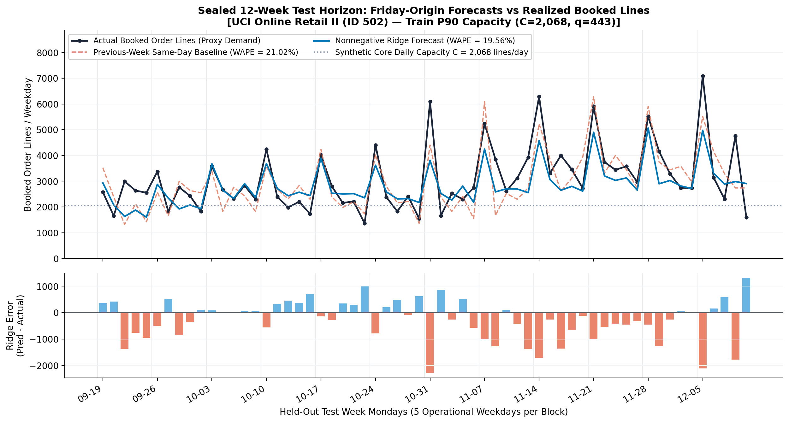
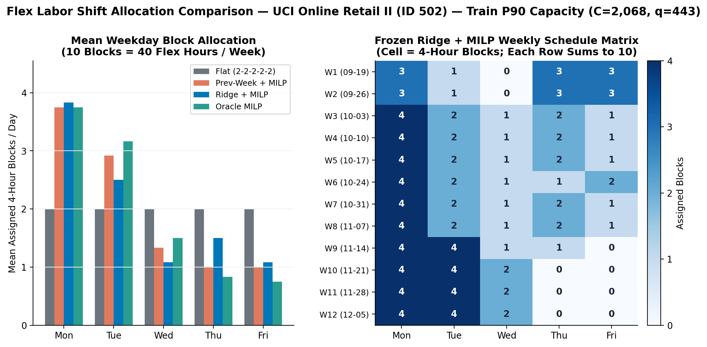
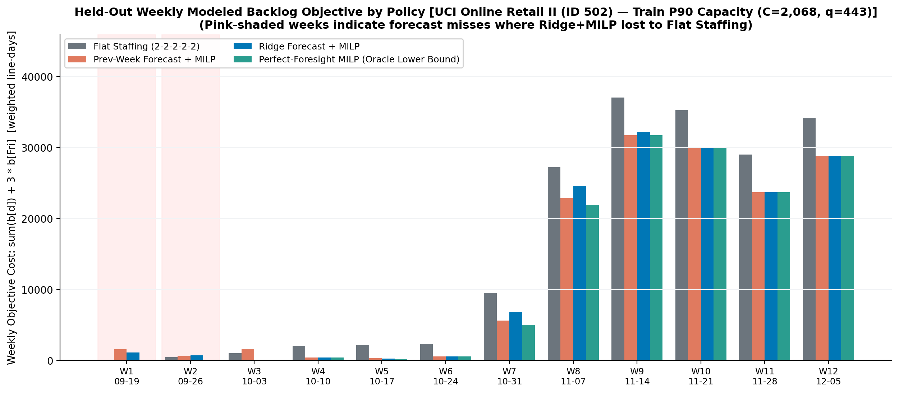
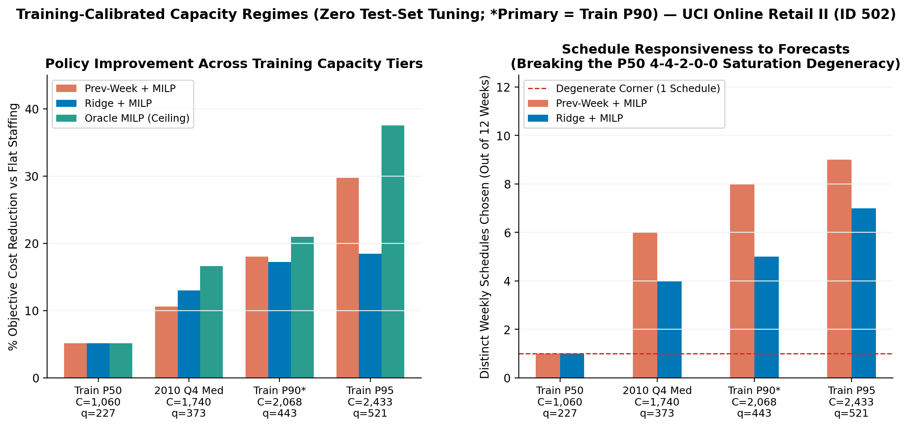
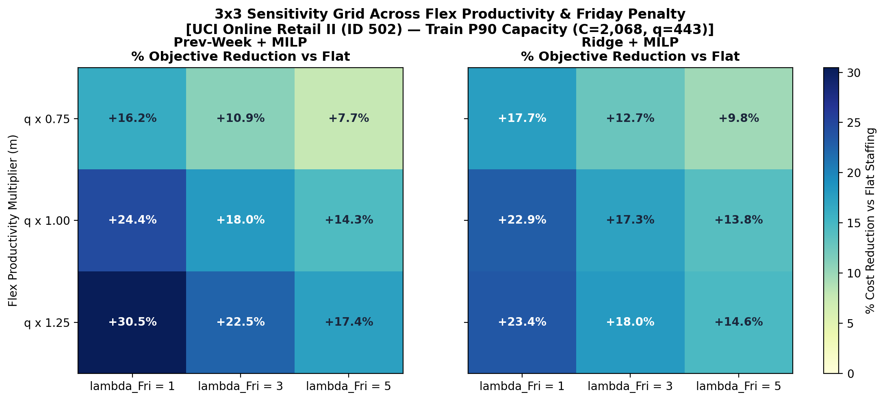

# Warehouse Flex Staffing & Demand Forecasting Optimizer

End-to-end operations research and demand-forecasting pipeline for weekly flexible warehouse labor scheduling, built with [DuckDB SQL](https://duckdb.org/docs/2.0/sql/introduction), chronological L2-regularized regression, and Mixed-Integer Linear Programming ([Pyomo + HiGHS](https://pyomo.readthedocs.io/en/6.8.0/library_reference/appsi/appsi.html)) on the **1,067,371-transaction** [UCI Online Retail II Dataset (ID 502)](https://archive.ics.uci.edu/dataset/502/online+retail+ii) ([DOI: 10.24432/C5CG6D](https://doi.org/10.24432/C5CG6D), Daqing Chen, CC BY 4.0).

## 1. Business Problem

Distribution centers supplement core full-time picking staff with a weekly pool of flexible part-time labor. Every **Friday afternoon**, operations planners must commit next week's Monday–Friday flexible shift schedule (**40 flex labor hours**, partitioned into **ten indivisible 4-hour blocks**, bounded at **0 to 4 blocks per weekday**) *before* next week's retail and wholesale orders arrive.

Assigning a static flat schedule (`2-2-2-2-2` blocks/day) ignores weekend order accumulation into Monday, Q4 giftware surges, and statutory holiday closures. Conversely, optimizing integer shifts deterministically against point forecasts exposes the warehouse to two distinct operational failure modes:
1. **Capacity Mis-Sizing (Saturation Degeneracy):** If peak-season core staffing is left at off-peak spring/summer medians, queues never clear on any weekday and every forecast collapses to the same front-loaded schedule (`4-4-2-0-0`).
2. **Zero-Boundary Misallocation:** In balanced weeks where queues periodically clear to zero, forecast errors can strand flex blocks on quiet days—wasting non-bankable picking capacity while exposing Friday to weekend SLA rollover penalties.

This repository evaluates **forecasting accuracy (WAPE)** and **realized queueing decisions** separately across strictly training-calibrated capacity regimes under a leak-free freeze-then-replay protocol.

## 2. Actual vs. Assumed Data & Cleaning Audit

Commercial invoices record order bookings—**not** physical warehouse floor telemetry. Estimated order-line arrivals and replayed queues are strictly treated as **modeled proxies**, never as observed warehouse performance.

| Dimension | Observed in [UCI Online Retail II](https://archive.ics.uci.edu/dataset/502/online+retail+ii) | Unobserved in Source Data | Modeled / Synthetic Assumption in This Repository |
| :--- | :--- | :--- | :--- |
| **Demand Unit** | `Invoice`, `StockCode`, `InvoiceDate`, `Quantity`, `Price`, `Customer ID`, `Country` across two sheets (`Year 2009-2010`: 525,461 rows; `Year 2010-2011`: 541,910 rows) | Physical SKU cube/weight, zone slotting, multi-order pick batching, wave cutoffs | **1 booked workload unit** = 1 unique valid `(invoice_no, stock_code)` order line |
| **Weekend Arrivals** | Sunday (and rare Saturday) invoice timestamps (`128,945` valid pairs) | Actual weekend shift operations | Weekend bookings folded into the **following operational Monday** (`Sat + 2d`, `Sun + 1d`) |
| **Core Picking Capacity ($C$)** | *Not observed* | Full-time headcount, attendance, travel speed | **Synthetic training-calibrated parameter:** $C = \text{round}(0.70 \times M_{\text{ref}})$ lines/day |
| **Flex Productivity ($q$)** | *Not observed* | Flex worker pick rate, learning curve, congestion | **Synthetic training-calibrated parameter:** $q = \max(1, \text{round}(0.15 \times M_{\text{ref}}))$ lines/block |
| **Queue Evolution ($b_d$)** | *Not observed* | Real-time WMS open-pick queue, carrier cutoffs | Discrete-time Lindley recursion $b_d = \max(0, b_{d-1} + y_d - C - q x_d)$ with weekly reset $b_0 = 0$ |

### Empirical DuckDB SQL Cleaning Funnel (`sql/workload.sql` & `results/uci/cleaning_audit.json`)
Executed on `online_retail_II.xlsx` (`SHA-256: bcbe73b35f5b7babf197fb0cb983a11f5d9ff929078d4aa53d171b1f2df2e980`):
* **Raw combined rows across both worksheets:** `1,067,371` (`525,461` in `Year 2009-2010` + `541,910` in `Year 2010-2011`).
* **Exact duplicate rows removed (including Dec 1–9, 2010 cross-sheet boundary overlap):** `-34,337` rows.
* **Cancellations (`C%`) and bad-debt accounting adjustments (`A%`) removed:** `-19,110` rows.
* **Nonpositive quantities (`quantity <= 0`) removed:** `-3,393` rows.
* **Nonpositive / zero unit prices (`unit_price <= 0.0001`) removed:** `-2,621` rows.
* **Documented administrative `StockCode`s removed** (`POST`, `DOT`, `M`, `D`, `CRUK`, `C2`, `BANK CHARGES`, `AMAZONFEE`, `B`, `S`, `PADS`, `SP1002`, `TEST%`, `ADJUST%`, `GIFT_%`): `-4,574` rows.
* **Intra-invoice duplicate `(invoice_no, stock_code)` lines collapsed to earliest date:** `-11,302` rows.
* **Final valid booked workload units:** **`992,034` unique `(invoice_no, stock_code)` order lines** across **`105` complete Monday–Friday weeks** (`525` weekdays, `2009-12-07` through `2011-12-09`).
* **Guest / wholesale orders without `Customer ID` intentionally retained:** `225,955` valid pairs (`22.8%` of workload—dropping missing customer IDs would severely undercount physical warehouse picking demand).
* **Contiguous Monday–Friday SQL spine:** `GENERATE_SERIES` + `COALESCE(..., 0)` explicitly zero-fills UK statutory bank holidays and late-December closures so 1-, 4-, and 52-week weekday shifts match exact 7-, 28-, and 364-calendar-day offsets.

## 3. Chronological Forecasting & Leakage Controls (`src/forecast.py`)

Each **Friday** of week $w - 1$, daily booked order lines $(\hat{f}_{w,0}, \dots, \hat{f}_{w,4})$ are forecasted for next Monday–Friday:
* **Baseline (`prev_week`):** Previous week's same-weekday workload $\hat{f}_{w,d} = y_{w-1,d}$.
* **Improved Candidate (`ridge`):** Standardized L2-regularized linear regression clipped at zero, $\hat{f}_{w,d} = \max(0, x_{w,d}^\top \hat{\beta} + \hat{\beta}_0)$, using strictly Friday-available features: `lag_1w`, `lag_4w`, `lag_52w`, prior-week mean, prior-4-week mean, one-hot weekday indicators (`Mon`–`Fri`), annual Fourier harmonics, Q4 peak indicator, Christmas closure indicator, and deterministic England & Wales statutory bank-holiday flags.
* **Chronological Evaluation Split (`105` complete weeks):**
  * **Initial Training (`weeks 0..84`, `2009-12-07` to `2011-07-22`):** Calibrates synthetic capacity $(C, q)$ and provides 52-week lag warm-up plus initial training folds.
  * **Rolling Validation (`weeks 85..92`, 8 complete weeks, `2011-07-25` to `2011-09-16`):** Selects $\alpha^* = 50.0$, cutting validation WAPE from **32.65%** (Previous-Week) to **22.42%** (Ridge).
  * **Sealed Test Set (`weeks 93..104`, final 12 complete weeks, `2011-09-19` to `2011-12-09`):** Evaluated once with locked $\alpha^* = 50.0$; Ridge achieves **19.56% WAPE** vs. **21.02% WAPE** for Previous-Week.

## 4. Five-Day MILP Formulation & Training Capacity Calibration (`src/model.py`)

### Variables, Parameters, and Units
| Symbol | Type | Units | Definition |
| :--- | :--- | :--- | :--- |
| $\hat{f}_d \ge 0$ | Input parameter | `lines / day` | Forecasted (or oracle) booked order lines on weekday $d \in \{0..4\}$ (`Mon`..`Fri`) |
| $M_{\text{ref}} > 0$ | Training reference | `lines / day` | Daily workload reference computed **strictly on Initial Training (`weeks 0..84`)** |
| $C \ge 0$ | Synthetic parameter | `lines / day` | Core daily picking capacity, $C = \text{round}(0.70 \times M_{\text{ref}})$ |
| $q \ge 1$ | Synthetic parameter | `lines / block` | Flex block productivity, $q = \max(1, \text{round}(0.15 \times M_{\text{ref}}))$ (`4-hr` block) |
| $m > 0$ | Sensitivity scalar | `dimensionless` | Productivity multiplier ($m \in \{0.75, 1.00, 1.25\}$), giving $q_{\text{eff}} = m \cdot q$ |
| $B = 10, \; U = 4$ | Shift constants | `blocks` | Exact weekly budget ($10 \text{ blocks} = 40\text{ flex hrs}$); daily cap $0 \le x_d \le 4$ |
| $b_{-1} = 0$ | Initial state | `lines` | Initial Monday-morning backlog (weekly reset assumption) |
| $\lambda_{\text{Fri}} = 3$ | Penalty weight | `day-equivalents` | End-of-week Friday carryover weight ($\{1, 3, 5\}$ in sensitivity) |
| $x_d \in \{0..4\}$ | **Integer variable** | `blocks` | Indivisible 4-hour flex staffing blocks assigned to weekday $d$ |
| $b_d \ge 0$ | **Continuous variable** | `lines` | Modeled end-of-day unpicked backlog at close of weekday $d$ |

$$\min_{x, b} \quad \sum_{d=0}^{4} b_d + \lambda_{\text{Fri}} \, b_4 \quad \text{s.t.} \quad \sum_{d=0}^{4} x_d = 10, \quad b_d \ge b_{d-1} + \hat{f}_d - C - q_{\text{eff}} x_d, \quad x_d \in \{0..4\}, \; b_d \ge 0$$

### Why Off-Peak `P50` Saturates in Q4 — and Training-Only `P90` Calibration
In the initial training set (`weeks 0..84`, Dec 2009–Jul 2011), 7 of 8 quarters occur in off-peak spring/summer (`median = 1,514 lines/day`), whereas Q4 giftware demand doubles (`Oct–Nov 2010 training median = 2,485–3,128 lines/day`). Under the year-round `P50` median ($C = 1{,}060, q = 227$, weekly capacity $5C + 10q = 7{,}570$ lines), historical 2010 Q4 training weeks already run at **180.5% median utilization**, leaving $b_d > 0$ every single day. By telescoping $b_d = \sum_{k=0}^d (\hat{f}_k - C - q x_k)$, a flex block on day $d$ saves $(5 - d + \lambda_{\text{Fri}})q$ objective units ($8q$ on Monday down to $4q$ on Friday), forcing **all 12 Q4 weeks** to select `4-4-2-0-0` regardless of the forecast.

To evaluate peak-season operations where forecasts genuinely govern shift timing—**without tuning on validation or test data**—we calibrate primary capacity to the **initial-training 90th percentile (`Train P90 = 2,954.0 lines/day` $\implies C = 2{,}068, q = 443$, weekly capacity $14{,}770$ lines)**, which centers historical 2010 Q4 training utilization at **0.925** (near balanced $\rho \approx 1.0$), and report all four training-derived capacity tiers side-by-side (`results/uci/capacity_regimes.csv`).

## 5. Empirical UCI Results (`results/uci/`)

### Primary Four-Policy Comparison (`Train P90`: $C = 2{,}068\text{ lines/day}, \; q = 443\text{ lines/block}, \; \lambda_{\text{Fri}} = 3$)

| Policy | Forecast WAPE (%) | Modeled Backlog (Line-Days) | Friday Carryover (Lines) | Total Objective Cost | Mean Weekly Cost | Rel. Improvement vs. Flat (%) | Gap vs. Oracle | Distinct Schedules | Win / Tie / Loss vs. Flat |
| :--- | :---: | ---: | ---: | ---: | ---: | ---: | ---: | :---: | :---: |
| **Flat Staffing (`2-2-2-2-2`)** | — | 113,335.0 | 22,230.0 | 180,025.0 | 15,002.08 | 0.00% | +37,757.0 | 1 | 0 / 12 / 0 |
| **Previous-Week + MILP** | 21.02% | 80,546.0 | 22,349.0 | 147,593.0 | 12,299.42 | **+18.02%** | +5,325.0 | 8 | 9 / 0 / 3 |
| **Ridge Forecast + MILP** | **19.56%** | 82,279.0 | **22,230.0** | 148,969.0 | 12,414.08 | **+17.25%** | +6,701.0 | 5 | **10 / 0 / 2** |
| **Perfect-Foresight MILP (Oracle)** | 0.00% | 75,578.0 | 22,230.0 | 142,268.0 | 11,855.67 | +20.97% | 0.0 | 7 | 12 / 0 / 0 |

* **Exploratory Paired Moving-Block Bootstrap ($L = 3\text{ weeks}$, $B = 10{,}000$ resamples, seed `42`):**
  * `Flat - Ridge MILP`: Mean saving **`+2,588.0` weighted line-days/week** (total `+31,056.0`), SE `814.4`, 95% CI **`[+1,064.0, +4,231.5]`** ($\mathbb{P}(\Delta > 0) = 100.0\%$).
  * `Flat - Prev-Week MILP`: Mean saving **`+2,702.7` weighted line-days/week** (total `+32,432.0`), SE `985.5`, 95% CI **`[+742.3, +4,551.6]`** ($\mathbb{P}(\Delta > 0) = 99.8\%$).
  * `Prev-Week MILP - Ridge MILP`: Mean difference **`-114.7` weighted line-days/week** (total `-1,376.0`), SE `283.1`, 95% CI **`[-695.6, +400.5]`** ($\mathbb{P}(\text{Ridge} > \text{Prev}) = 36.5\%$, spanning zero).

### Multi-Regime Training Capacity Evaluation (`results/uci/capacity_regimes.csv`)

| Training Capacity Regime (`weeks 0..84` only) | Train Ref (`lines/day`) | $(C, \; q)$ | Weekly Cap (`lines`) | 2010 Q4 Train Med. Util. | Distinct Scheds (Prev / Ridge / Oracle) | Flat Cost | Prev-Week + MILP (% vs. Flat) | Ridge + MILP (% vs. Flat) | Oracle MILP (% vs. Flat) |
| :--- | ---: | :---: | ---: | :---: | :---: | ---: | ---: | ---: | ---: |
| `train_p50_median` *(Off-Peak Saturated)* | 1,514.0 | `(1060, 227)` | 7,570 | `1.80x` | `1 / 1 / 1` | 635,671 | 602,983 (+5.14%) | 602,983 (+5.14%) | 602,983 (+5.14%) |
| `train_q4_peak_median` *(2010 Q4 Median)* | 2,485.0 | `(1740, 373)` | 12,430 | `1.10x` | `6 / 4 / 5` | 291,804 | 260,907 (+10.59%) | **253,838 (+13.01%)** | 243,279 (+16.63%) |
| **`train_p90_quantile` *(Primary Peak)*** | **2,954.0** | **`(2068, 443)`** | **14,770** | **`0.92x`** | **`8 / 5 / 7`** | **180,025** | **147,593 (+18.02%)** | 148,969 (+17.25%) | **142,268 (+20.97%)** |
| `train_p95_quantile` *(High-Buffer Peak)* | 3,476.0 | `(2433, 521)` | 17,375 | `0.79x` | `9 / 7 / 8` | 90,348 | **63,457 (+29.76%)** | 73,702 (+18.42%) | 56,443 (+37.53%) |

### Why Forecast Accuracy and Staffing Cost Diverge Across Regimes
Analyzing WAPE (`19.56%` Ridge vs. `21.02%` Previous-Week) alongside MILP cost across the four regimes above exposes a core operations-research insight:
1. **Under moderate peak congestion (`2010 Q4 Median`, $\rho_{\text{train}} = 1.10$, and `0.75q` sensitivity), Ridge + MILP beats Previous-Week + MILP (`+13.01%` vs. `+10.59%`):** Naive 1-week lags chase transient mid/late-week noise, leaving Friday exposed (`37,569` vs. `36,410` Friday spillover lines at Q4 Median), whereas Ridge's regularized weekday profile allocates blocks cleanly across Monday/Tuesday/Thursday.
2. **Under higher capacity (`Train P90` and `Train P95`), L2 variance shrinkage trades peak-inflection aggressiveness for fewer loss weeks:** In Week 3 (`2011-10-03`), Ridge achieves `2.03%` WAPE and `0.0` backlog (`+984` saving vs. Flat) while Previous-Week suffers a `-632` loss (`1,616` cost). However, during the sharp November giftware inflection in Weeks 7–8 (`2011-10-31` and `2011-11-07`), Ridge's L2 shrinkage ($\alpha^* = 50$) retains 2 blocks on Thursday and 1 on Friday (`4-2-1-2-1`), whereas unshrunk Previous-Week shifts more aggressively toward Monday/Tuesday (`4-4-0-2-0` and `4-4-1-0-1`), gaining `1,177` and `1,772` line-days on those two ramp weeks.

### Week-by-Week Sealed Test Breakdown (`Train P90`, All 12 Held-Out UCI Weeks)

| Wk | Week Monday | Actual Lines | Prev-Wk WAPE | Ridge WAPE | Flat Sched | Prev-Wk Sched | Ridge Sched | Oracle Sched | Flat Cost | Prev-Wk Cost | Ridge Cost | Oracle Cost | Ridge Saving vs. Flat | Outcome |
| :---: | :---: | ---: | ---: | ---: | :---: | :---: | :---: | :---: | ---: | ---: | ---: | ---: | ---: | :---: |
| 1 | `2011-09-19` | 12,415 | 40.3% | 31.1% | `2-2-2-2-2` | `4-1-0-2-3` | `3-1-0-3-3` | `2-0-3-2-3` | 42 | 1,538 | 1,095 | 0 | -1,053 | **Loss** |
| 2 | `2011-09-26` | 12,217 | 17.5% | 18.9% | `2-2-2-2-2` | `2-0-3-2-3` | `3-1-0-3-3` | `3-0-2-1-4` | 421 | 599 | 699 | 0 | -278 | **Loss** |
| 3 | `2011-10-03` | 13,702 | 17.4% | **2.0%** | `2-2-2-2-2` | `3-0-2-1-4` | `4-2-1-2-1` | `4-2-1-2-1` | 984 | 1,616 | **0** | 0 | +984 | Win |
| 4 | `2011-10-10` | 12,544 | 19.7% | 19.3% | `2-2-2-2-2` | `4-2-1-2-1` | `4-2-1-2-1` | `4-4-0-2-0` | 2,006 | 400 | 400 | 400 | +1,606 | Win |
| 5 | `2011-10-17` | 12,564 | 9.4% | 16.3% | `2-2-2-2-2` | `4-4-0-2-0` | `4-2-1-2-1` | `4-4-1-1-0` | 2,119 | 279 | **222** | 188 | +1,897 | Win |
| 6 | `2011-10-24` | 12,571 | 12.0% | 17.4% | `2-2-2-2-2` | `4-4-1-1-0` | `4-2-1-1-2` | `4-4-0-2-0` | 2,326 | 563 | 563 | 563 | +1,763 | Win |
| 7 | `2011-10-31` | 15,328 | 28.8% | 29.2% | `2-2-2-2-2` | `4-4-0-2-0` | `4-2-1-2-1` | `4-4-1-0-1` | 9,415 | 5,580 | 6,757 | 4,985 | +2,658 | Win |
| 8 | `2011-11-07` | 18,754 | 27.5% | 22.1% | `2-2-2-2-2` | `4-4-1-0-1` | `4-2-1-2-1` | `4-4-2-0-0` | 27,246 | 22,816 | 24,588 | 21,930 | +2,658 | Win |
| 9 | `2011-11-14` | 19,784 | 22.8% | 20.6% | `2-2-2-2-2` | `4-4-2-0-0` | `4-4-1-1-0` | `4-4-2-0-0` | 37,058 | 31,742 | 32,185 | 31,742 | +4,873 | Win |
| 10 | `2011-11-21` | 19,641 | 8.8% | 13.9% | `2-2-2-2-2` | `4-4-2-0-0` | `4-4-2-0-0` | `4-4-2-0-0` | 35,262 | 29,946 | 29,946 | 29,946 | +5,316 | Win |
| 11 | `2011-11-28` | 18,446 | 11.0% | 11.2% | `2-2-2-2-2` | `4-4-2-0-0` | `4-4-2-0-0` | `4-4-2-0-0` | 29,025 | 23,709 | 23,709 | 23,709 | +5,316 | Win |
| 12 | `2011-12-05` | 18,897 | 35.7% | 31.4% | `2-2-2-2-2` | `4-4-2-0-0` | `4-4-2-0-0` | `4-4-2-0-0` | 34,121 | 28,805 | 28,805 | 28,805 | +5,316 | Win |

### $3 \times 3$ Sensitivity Grid (`Train P90` Base Capacity, `results/uci/sensitivity_grid.csv`)

| Productivity Multiplier ($m$) | Effective $q_{\text{eff}}$ (`lines/block`) | Friday Penalty ($\lambda_{\text{Fri}}$) | Flat Cost | Prev-Week + MILP (% vs. Flat) | Ridge + MILP (% vs. Flat) | Oracle MILP Cost |
| :---: | :---: | :---: | ---: | ---: | ---: | ---: |
| `0.75` | `332.25` | `1` | 168,238.5 | 141,007.2 (+16.19%) | **138,446.0 (+17.71%)** | 133,426.5 |
| `0.75` | `332.25` | `3` | 226,067.5 | 201,471.2 (+10.88%) | **197,318.5 (+12.72%)** | 191,255.5 |
| `0.75` | `332.25` | `5` | 283,896.5 | 261,935.2 (+7.74%) | **256,191.0 (+9.76%)** | 249,084.5 |
| `1.00` | `443.00` | `1` | 135,565.0 | **102,452.0 (+24.43%)** | 104,509.0 (+22.91%) | 97,722.0 |
| `1.00` | `443.00` | `3` | 180,025.0 | **147,593.0 (+18.02%)** | 148,969.0 (+17.25%) | 142,268.0 |
| `1.00` | `443.00` | `5` | 224,485.0 | **192,291.0 (+14.34%)** | 193,429.0 (+13.83%) | 186,728.0 |
| `1.25` | `553.75` | `1` | 107,247.5 | **74,571.5 (+30.47%)** | 82,117.0 (+23.43%) | 66,308.0 |
| `1.25` | `553.75` | `3` | 139,516.5 | **108,194.5 (+22.45%)** | 114,386.0 (+18.01%) | 98,654.0 |
| `1.25` | `553.75` | `5` | 171,785.5 | **141,817.5 (+17.45%)** | 146,655.0 (+14.63%) | 131,000.0 |

### Diagnostic Visualizations (`results/uci/figures/`)







## 6. Repository Architecture & Reproduction

```text
warehouse-flex-staffing-optimizer/
├── README.md                          # Empirical UCI documentation, math, tables & figures
├── requirements.txt                   # Pinned Python 3.11+ dependencies (DuckDB, Pyomo, HiGHS, etc.)
├── Makefile                           # Targets: install, test, reproduce, reproduce-cached
├── configs/base.yml                   # Cleaning, lags, Train-P90 primary & 4-regime configuration
├── sql/workload.sql                   # DuckDB SQL cleaning, deduplication, weekend folding & spine
├── src/
│   ├── calendar.py                    # Weekend folding, Mon-Fri spine & UK statutory holiday features
│   ├── workload.py                    # Dual-sheet Excel loader, cleaning funnel audit & SQL runner
│   ├── forecast.py                    # Leakage-free Friday-origin Prev-Week & Nonnegative Ridge models
│   ├── model.py                       # Training capacity calibration, Pyomo+HiGHS MILP & 381-enumerator
│   ├── replay.py                      # Frozen-schedule replay, 4-regime suite, sensitivity & bootstrap
│   ├── charts.py                      # Matplotlib visualizations (5 figures)
│   └── cli.py                         # CLI (`download` and `run` supporting `.xlsx` or `--from-daily-csv`)
├── scripts/
│   ├── reproduce.sh                   # Full raw-data reproduction (downloads 43.5 MB UCI `.xlsx`)
│   ├── render_uci_report.py           # Auto-verifies & renders `results/uci/resume_bullets.md`
│   └── generate_synthetic_fixture.py  # Offline synthetic two-sheet CI fixture generator
├── tests/                             # 14 automated unit & integration tests
├── report/brief.md                    # One-page operations planning recommendation brief
└── results/uci/                       # Verified empirical UCI CSVs, JSON manifests & PNG charts
```

### Option A: Full End-to-End Reproduction from Raw UCI Excel (`1,067,371` rows)
Downloads the 43.5 MB `online_retail_II.xlsx` workbook directly from [UCI Dataset 502](https://archive.ics.uci.edu/dataset/502/online+retail+ii), runs [DuckDB SQL](https://duckdb.org/docs/2.0/sql/introduction) cleaning, fits Ridge, solves [Pyomo + HiGHS](https://pyomo.readthedocs.io/en/6.8.0/library_reference/appsi/appsi.html) MILPs, and regenerates `results/uci/`:

```bash
python3 -m venv .venv
source .venv/bin/activate
pip install -r requirements.txt
bash scripts/reproduce.sh
```

### Option B: Instant Offline Reproduction from Committed UCI Daily Spine (`< 3 seconds`)
Because `online_retail_II.xlsx` (`43.5 MB`) is excluded from Git via `.gitignore`, reviewers can also independently re-verify every forecast, MILP schedule, capacity regime, sensitivity cell, bootstrap CI, and chart directly from the committed 525-day `results/uci/daily_workload.csv` table without downloading the raw Excel archive:

```bash
make test
make reproduce-cached
```

## 7. Limitations & Next Steps

1. **Order-Line Proxy & Homogeneous Pick Standards:** Invoice–SKU pairs omit SKU cube/weight, zone travel, and multi-order tote batching. *Next step:* Calibrate zone-stratified pick minutes per line from WMS scan telemetry.
2. **Weekly Zero-Backlog Reset ($b_0 = 0$):** Resetting Monday morning backlog isolates weekly scheduling decisions (paired with the $3 \times b_{\text{Fri}}$ penalty) but omits multi-week rollover during sustained November congestion. *Next step:* Add continuous state carryover $b_{w,0} = b_{w-1,\text{Fri}}$.
3. **Deterministic Point-Forecast Loss on Shoulder Weeks (`W1`, `W2`):** In balanced shoulder weeks (`W1`, `W2`), deterministic MILPs ignore forecast variance around the convex `max(0, .)` kink ($\mathbb{E}[\max(0, Z)] \ge \max(0, \mathbb{E}[Z])$), over-emptying mid-week shifts (`3-1-0-3-3` when Wednesday surged). *Next step:* Formulate a **two-stage stochastic MILP** over empirical validation residuals or train with **Smart Predict-Then-Optimize (`SPO+`)** decision loss.
